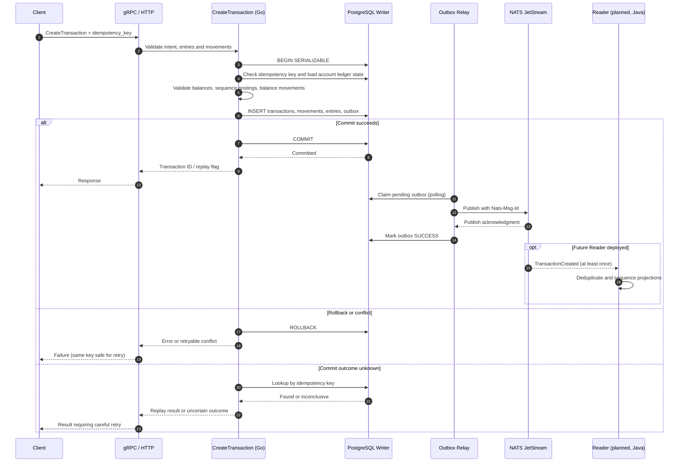

# isura-ledger-writer-ms

The double-entry accounting engine of Isura Bank. **Every financial movement goes through here.**

This service is the financial source of truth: it stores immutable debit/credit entries and their per-account running balances, groups postings into balanced business movements, enforces atomic bookkeeping, and publishes committed events reliably through the Transactional Outbox pattern.

---

## Responsibilities

- Double-entry bookkeeping — debit + credit = 0, always atomic via a single PostgreSQL transaction
- Real-time balance per account
- Transaction idempotency via `idempotency_key` with `UNIQUE CONSTRAINT`
- Reliable event publishing via Transactional Outbox → NATS JetStream
- Accounting representation of accounts (asset, liability, revenue, expense, equity)
- Required balanced `movements` grouping transaction entries with an immutable type and statement description

---

## Architecture

This service follows **Hexagonal Architecture** with **tactical Domain-Driven Design**, organized into `transaction`, `account`, `hold`, and `outbox` modules inside the **Ledger bounded context**.

### Dependency rule

```
transport → application → domain ← infrastructure
```

The `domain` layer imports nothing external. The `infrastructure` layer implements the interfaces defined in `domain`. The `transport` layer knows only about `application` use cases.

### Project structure

The service is organized by domain, application use cases, adapters and infrastructure. Key paths:

```text
cmd/server/                         # Service bootstrap
internal/domain/transaction/        # Transaction, Entry, Movement, domain events
internal/domain/account/            # Accounting accounts and balance policy
internal/domain/hold/               # Hold types, validation, allocation policy and snapshot evaluator
internal/domain/outbox/             # Outbox domain model
internal/application/command/       # CreateTransaction and other commands
internal/application/dto/           # REST/application payload validation
internal/infra/postgres/repository/ # PostgreSQL persistence, including movements
internal/infra/postgres/uow/        # pgx Unit of Work
internal/infra/nats/                # NATS JetStream outbox relay
internal/transport/                 # HTTP and gRPC adapters
db/                                 # Atlas HCL schemas, including movements.pg.hcl
proto/                              # Protobuf contracts
tests/                              # Unit, integration and chaos tests
```

---

## Domain model

### Money — Value Object

Monetary values are stored as `int64` cents — never `float64`. This eliminates floating-point precision errors in financial calculations.

```
Money { amount int64, currency Currency }

BRL → "BRL" | USD → "USD" | EUR → "EUR"
```

Operations: `Add`, `Subtract`, `Equal`, `IsSufficientBalance`, `IsZero`, `IsNegative`, `IsPositive`, `String` (e.g. `"100.50 BRL"`).

### Transaction — Aggregate Root

The central aggregate. Enforces double-entry invariants and owns its state machine.

```
PENDING → COMPLETED  ✓
PENDING → FAILED     ✓
COMPLETED → any      ✗
FAILED → any         ✗
```

A `Transaction` contains **at least two** `Entry` records. It may contain multiple balanced movements (for example TED + fee). Debit and credit totals must balance, the transaction currency is consistent, and each entry belongs to exactly one individually balanced `Movement`. The aggregate validates these invariants before persistence.

### Entry — Entity

Represents one side of a double-entry ledger. Belongs to a `Transaction` aggregate — never created independently.

```
Entry {
  ID             EntryID
  TransactionID  TransactionID
  AccountID      AccountID
  SequenceNumber int64
  RunningBalance int64
  Direction      DEBIT | CREDIT
  Amount         Money
  CreatedAt      time.Time
}
```

### Movement — Entity inside Transaction

A movement represents one business purpose within the accounting transaction, such as a TED transfer or its fee. Unlike the earlier JSONB proposal, **the implementation on `main` uses a relational `movements` table with a movement ID**.

```text
Transaction
  Movement (TED_TRANSFER, "TED enviada")
    Entry: DEBIT  100000 cents
    Entry: CREDIT 100000 cents
  Movement (TED_FEE, "Tarifa TED")
    Entry: DEBIT    1000 cents
    Entry: CREDIT   1000 cents
```

A movement has `id`, `transaction_id`, `type`, and required nonblank `description`. Each `Entry` has a `movement_id`; the composite foreign key `(movement_id, transaction_id)` enforces that referenced movements belong to the same transaction. The domain also checks that movement entries balance independently, no entry is assigned twice, and every entry belongs to one movement. Amounts remain authoritative in `entries`, not in a duplicate JSON document.

The API accepts movements with zero-based `entry_positions`, which the Writer resolves to generated entry IDs. The grouping and descriptions participate in the idempotency fingerprint.

### Account — Entity

Accounting representation of a bank account within the ledger. Not the same as the customer-facing account in `isura-account-ms` — the ledger holds only what it needs for bookkeeping.

```
Account {
  ID             AccountID
  AccountExternalID     string      // ID from isura-account-ms (correlation key)
  AccountingType ASSET | LIABILITY | REVENUE | EXPENSE | EQUITY
  BalancePolicy  BALANCE_NON_NEGATIVE | BALANCE_UNRESTRICTED
  Currency       Currency
  CreatedAt      time.Time
  UpdatedAt      time.Time
}
```

### Funds holds — Domain snapshot

`internal/domain/hold` models restrictions on the availability of funds separately from the account's status and accounting entries. It recognizes `JUDICIAL`, `REGULATORY`, `GUARANTEE`, `CONTRACTUAL`, and `OPERATIONAL` as declared hold types; these labels do not establish legal validity or authority.

The package provides a pure evaluator for a caller-supplied snapshot: eligible funds, active allocations, new requests, and an explicitly versioned operational policy. It subtracts existing active allocations before evaluating requests and returns the requested, allocated, and pending amounts with a status, policy version, conflict IDs, and reason. It does not change account status, create a debit or transfer, persist a hold, or coordinate concurrent evaluations across snapshots.

The caller must determine legal and business eligibility—including applicable guarantees and restrictions—before passing `EligibleFunds`. The evaluator treats that amount as numerically eligible; it does not perform the legal eligibility assessment.

`Policy.TypeOrder` is an operational order, not a universal legal priority. A request whose type is absent from the configured order always receives `PENDING_REVIEW`, even when the numeric funds are sufficient; missing configuration is not authorization. Unresolved competition also goes to review rather than being broken by request ID or date. Duplicate request IDs and duplicate active allocation IDs make the snapshot invalid.

`HoldDecision` is a returned value, not an immutable object: callers can modify its exported fields. The evaluator does not mutate inputs or previously returned decisions, and it creates independent conflict ID slices. Persisting decisions for a durable audit history is the responsibility of a later integration.

### OutboxEvent — Aggregate

Ensures reliable event delivery to NATS JetStream without dual writes. Persisted in the same PostgreSQL transaction as the `Transaction`. The relay claims pending events in PostgreSQL and publishes them to JetStream using the outbox ID as `Nats-Msg-Id` for deduplication.

```
PENDING → FAILED    ✓  (publish attempt failed)
PENDING → SUCCESS   ✓  (published successfully)
FAILED  → PENDING   ✓  (retry — if Attempts < MaxAttempts)
SUCCESS → any       ✗
```

---

## Key design decisions

### Transactional Outbox

The Writer persists each transaction, its movements, entries, and its outbox event atomically. The outbox relay then publishes committed events to NATS JetStream:

```text
CreateTransaction
       │
       └── PostgreSQL transaction
             ├── transactions
             ├── movements (purpose + description)
             ├── entries (financial postings, each linked to a movement)
             └── outbox_events
                     │
                     └── OutboxRelay → NATS JetStream
```

All writes happen in one PostgreSQL transaction:

```
BEGIN
  INSERT INTO transactions ...
  INSERT INTO movements ...
  INSERT INTO entries ...      (all debit/credit postings)
  INSERT INTO outbox_events ... (event payload)
COMMIT
```

`accounts` stores account identity, currency, status, and balance policy. For ledger transactions, `entries` is the append-only record of financial postings, ordered per account by `sequence_number`; each entry stores the resulting `running_balance`, and the latest entry provides the balance used by the transaction flow. The normal transaction flow inserts entries and does not update or delete previously committed entries. The existing `balances` table and its account-creation event handler are a separate legacy/bootstrap record and are not the source used to calculate a transaction's running balance. This initiative does not change or remove that table. If a transaction commit fails, its transaction, movements, entries, and outbox event are all rolled back. After commit, the relay publishes the event to JetStream.

`transactions` stores the operation envelope, status, and idempotency key/fingerprint. `outbox_events` stores integration events in the same PostgreSQL transaction as their ledger operation; the relay publishes committed events to JetStream and can retry failed deliveries. Historical balance backfill is a separate operational maintenance flow that can recalculate `entries.running_balance`; it is outside the normal append-only transaction flow and is not changed here.

### Idempotency

The `transactions.idempotency_key` has a **global UNIQUE index** in the Writer database, not a per-account or per-movement scope. Callers must therefore supply a key that is unique across the entire Writer namespace.

The request fingerprint is a **SHA-256 digest of the canonicalized business request**, including normalized posting intent, movement descriptions, movement types and entry positions. A fingerprint is a digest, not the original business payload; accidental cryptographic collisions are theoretically possible but considered computationally infeasible with SHA-256. A routine idempotency conflict (same key, different canonical payload) is **not** a hash collision. The same key with the **same** fingerprint returns the original transaction ID and `idempotent_replay: true` (no new entries, movements, or outbox event). The same key with a **different** fingerprint is an idempotency conflict. Concurrent unique-key races are resolved by looking up the committed transaction; an ambiguous commit is investigated by idempotency key instead of blindly submitting a second write.

> Trade-off: global uniqueness simplifies enforcement but requires cross-product key coordination or namespace-prefixed keys. A per-tenant/account key scope would require schema and contract changes; it is not the current implementation.

### Unit of Work

The `UnitOfWork` interface wraps the PostgreSQL transaction lifecycle. All repository calls within a use case's `Execute` method receive a `context.Context` carrying the active `pgx.Tx`. Each repository's `resolveDB` method picks the transaction over the connection pool when present.

```go
return c.uow.WithRetryableTransaction(ctx, func(ctxTx context.Context) error {
    // transaction, movements, entries, and outbox use one pgx.Tx
    if err := c.transactionRepository.Save(ctxTx, tx); err != nil {
        return err
    }
    return c.outboxRepository.Save(ctxTx, event)
})
```

### Running balance and concurrency trade-offs

Each `Entry` stores its **own immutable `running_balance`** and `sequence_number`, both calculated on the write path. The entry with the **highest `sequence_number` for an account** is the operational source of its balance. This assumes that each committed posting is sequenced and its stored balance accounts for all earlier committed postings. A gap alone does not mathematically invalidate a latest balance if it is a deliberate, accounted-for gap; however, the current reconciliation routine treats **gaps between successive persisted entries** as an error. An imported stream may start above sequence 1 when its earlier opening history is unavailable. Retroactive inserts or changes to historical postings require explicit recalculation/reconciliation of affected running balances. **The normal posting path does not `UPDATE` a single balance row per posting**: it inserts new entries. A separate existing `balances` table supports a legacy/bootstrap flow and is not the transactional balance authority. Historical backfill is an explicitly separate maintenance path.

This approach allows deterministic per-account reconstruction and efficient latest-balance lookups, at the cost of write-side sequencing and contention for **hot accounts** (for example a shared settlement account). Distinct transactions can contend even without balance-row updates because they compete for the next account sequence and serializable validation.

The Unit of Work uses PostgreSQL `SERIALIZABLE` transactions. `TransactionRepository.FindLatestLedgerState` reads each account's last persisted `sequence_number` and `running_balance` with `ORDER BY sequence_number DESC LIMIT 1`. `AssignLedgerEntries` applies the requested entries **in input order**, incrementing the per-account sequence and computing each new running balance in memory before insert. This is **not** a PostgreSQL sequence, an in-memory global counter, or a balance-row `UPDATE`. Accounts touched by the transaction are collected in a stable sorted order for state lookup. `UNIQUE(account_id, sequence_number)` provides the database conflict guard. Supported serialization/concurrency conflicts are retried with bounded exponential backoff and jitter (default maximum **5 attempts**). After the default five retry attempts are exhausted, the Unit of Work returns a **transaction conflict** (wrapping `ErrMaxRetriesExceeded`); it does not enqueue the unsuccessful financial write in the Outbox. Callers may retry the same business request using the **same idempotency key and identical payload**, respecting backoff; a different payload with that key is a conflict. In ambiguous-commit situations the application checks by idempotency key, but if that check cannot establish the result it returns an uncertain outcome rather than claiming a rollback. Under sustained contention, such failures should be monitored. A balance cache or checkpoint is an architectural alternative, **not** the source of truth in the current normal write path.

### Outbox delivery semantics

The current implementation is a **polling relay**, not Debezium/CDC. It claims pending/failed Outbox records in PostgreSQL, publishes batches using bounded concurrent workers to NATS JetStream, and records the publish result. Each message uses the outbox identifier as `Nats-Msg-Id` for broker-side deduplication.

The delivery contract is **at least once**, not end-to-end exactly once. A relay can publish successfully and lose the acknowledgment or fail before recording `SUCCESS` in PostgreSQL; a later retry can therefore redeliver. JetStream deduplication is bounded by its configured duplicate window. Consumers (including the future Java Reader) must deduplicate using stable `event_id` values and apply projections idempotently. Consumers projecting per-account balances must also handle event reordering or gaps using entry `sequence_number`. An Outbox row or a JetStream stream is **not** an indefinite event archive by default.

### Dead-letter publication and retry exhaustion

The Outbox relay **does implement a dead-letter publish attempt**. If a publish failure reaches `NATS_RELAY_MAX_ATTEMPTS`, it tries publishing the original payload to the configured `DLQSubject`; when that is empty, the subject falls back to the event type plus the defined DLQ suffix. The dead-letter message uses `Nats-Msg-Id: <outbox-id>.dlq` for deduplication.

The original PostgreSQL Outbox record remains in `FAILED` state; `ClaimPending` selects only records with `attempts < maxAttempts`, so exhaustion stops normal automatic retries.

**Independent retry budgets:** the PostgreSQL Unit of Work defaults to **5 attempts** for write-path concurrency conflicts; `NATS_RELAY_MAX_ATTEMPTS=3` is the example/default publishing budget for the **post-commit relay**. Exhausting either budget has different consequences: an unsuccessful financial write is rolled back, whereas an exhausted relay leaves a previously committed financial write and a `FAILED` Outbox record. **DLQ delivery is not guaranteed by this code path**: the broker or configured stream may be unavailable, and a DLQ publish failure is logged. This relay does not itself demonstrate a DLQ consumer, automatic redrive or guaranteed DLQ stream provisioning. Operators should inspect the failed Outbox records and subject/stream configuration before any controlled redrive.

### Observability signals

The following are **actual OpenTelemetry instrument names** defined in `internal/infra/observability/prometheus.go` and exported through the configured Prometheus integration. Metric exporters may normalize names or units; confirm the resulting series in `/metrics` before writing PromQL or production alerts.

| Instrument | Type | Labels | Use |
|---|---|---|---|
| `ledger_concurrency_retries_total` | Counter | none | Retry pressure from serialization/concurrency conflicts |
| `ledger_idempotency_total` | Counter | `result` | New, replay and conflict outcomes |
| `ledger_outbox_total` | Counter | `status`, `event_type` | Successful or failed Outbox publication attempts |
| `ledger_command_total` | Counter | `command`, `state` | Use-case / relay execution outcomes |
| `ledger_command_duration_milliseconds` | Histogram | `command` | Command latency distributions |
| `ledger_db_query_duration_milliseconds` | Histogram | `database`, `table`, `method` | Database operation latencies |
| `ledger_grpc_request_duration_milliseconds` | Histogram | `router`, `status_code`, `protocol` | Instrumented request latency |
| `ledger_requests_total` | Counter | `router`, `status_code`, `protocol` | Traffic and response errors |
| `ledger_transactions_total` | Counter | `status` | Transaction state totals |

**Not currently evidenced as dedicated instruments:** Outbox pending age, Reader projection lag, and per-hot-account throughput. These require additional instrumentation and operational targets before they can support meaningful alerts. Never publish account identifiers as high-cardinality metric labels.

### Performance validation

No production throughput, p99 latency or hot-account TPS objective has been approved in this README. `make chaos-tests` validates failure and recovery scenarios; **it is not a capacity benchmark**. For a reproducible baseline, record the tested revision, hardware, Go/PostgreSQL versions, connection pool, account distribution (independent versus highly contended settlement account), client concurrency, duration, successes/conflicts and p50/p95/p99 latency. Publish numbers only after running that workload and keep development results distinct from production SLOs.

### Currency scope and financial controls

Accounts record their currency, and transaction entries must be in one matching currency: **a single current transaction cannot post entries in multiple currencies**. The system supports currency-specific amounts, not an implemented cross-currency/FX booking model. FX would require explicit conversion/rate records and additional accounting invariants.

The repository contains a ledger reconciliation routine that replays account entries and checks persisted running balances. This is distinct from **end-of-period accounting close**, which is not established as implemented here. Period closing, retention policies, operational SLAs, backup schedules and PostgreSQL point-in-time recovery (PITR) targets must be separately defined before production readiness claims.

### Balance reconciliation: execution and response

Run **`make reconcile-balances`** (equivalent to `go run ./cmd/reconcile`) against the configured Writer PostgreSQL instance. This is a manually invoked command in this repository: no recurring schedule, cron, or alerting pipeline is implied.

The command opens a **read-only REPEATABLE READ transaction** with a five-minute context timeout, replays the account ledger in sequence order, and emits a JSON report with counts and any recorded balance mismatches. It returns a nonzero exit status if the reconciliation report is not reconciled or if validation/querying fails (including an unexpected internal sequence gap). **It does not repair balances**, emit corrective ledger postings, or close a fiscal period. On-call response to any discrepancy should preserve evidence and investigate the affected account and sequence before a separately approved correction/backfill.

### Failure modes and recovery

| Failure scenario | Expected Writer behavior | Recovery / operator action |
|---|---|---|
| PostgreSQL unavailable before or during a write | The command fails; an uncommitted UoW cannot create a partial transaction/movement/entry/Outbox set. | Restore database connectivity; retry with the **same** idempotency key. |
| Commit response lost / commit outcome ambiguous | The command attempts a bounded lookup by idempotency key and fingerprint; if inconclusive it reports an uncertain outcome rather than assuming failure. | Check the persisted transaction before retrying; use the original key/payload, never a fresh key for the same business action. |
| Hot-account conflict / serialization retry exhaustion | Serializable transaction is retried with backoff, then returns a transaction-conflict error after the bounded budget; no Outbox item is committed for a rejected attempt. | Back off and retry the same request/key; investigate account contention and retry metrics if persistent. |
| NATS JetStream unavailable after DB commit | Financial data and Outbox record remain committed; the relay records a failed publish attempt when possible. | Restore NATS; inspect Outbox failures/retry counts. At the attempt limit the relay **attempts** a DLQ publish; verify whether the subject/stream accepted it before controlled redrive. |
| Relay stops after broker publish but before DB success update | JetStream may already hold the event while Outbox still requires another attempt. | Restart/retry relay; consumers must deduplicate on stable `event_id` because delivery is at least once. |
| Reader receives a duplicate or out-of-order event | The Writer's committed ledger remains authoritative; projection correctness is the consumer's responsibility. | Reader deduplicates, detects gaps per account via `sequence_number`, and only advances a projection when prerequisites are satisfied. |
| Reconciliation finds a mismatch or internal sequence gap | Read-only audit reports the inconsistency or fails validation; no automatic correction occurs. | Investigate and preserve evidence; use a separately approved recovery/correction procedure. |

These are **implementation semantics**, not an operational SLA or a guarantee of automated restoration. Confirm monitoring thresholds, retention, DLQ handling, runbooks and recovery exercises separately.

### Event schema evolution for the Java Reader

The current internal NATS payload is the JSON `TransactionCreated` event, produced from the Go domain definition in `internal/domain/transaction/event.go`. The current producer sets **`event_version: 1`**, and the Outbox payload carries `event_id`, transaction fields, ordered `entries` (including account `sequence_number`, `running_balance`, and `movement_id`), and `movements` (type, description, and `entry_ids`).

**Proposed compatibility policy** for the future independently deployed Java Reader:

- Treat a published event version as an immutable contract; never silently change the meaning or units of existing fields.
- Prefer additive, optional fields for backward-compatible changes; consumers must ignore unknown optional fields.
- For incompatible changes, introduce a new explicit version and migration plan (support a transition period or separate event subject if necessary).
- Publish a language-neutral canonical contract (JSON Schema/AsyncAPI, plus producer-consumer compatibility tests) before connecting the Java Reader. The Go struct is currently the implementation source; a shared schema registry or formal language-neutral contract is **not yet established**.
- The Reader must persist processed `event_id` values, enforce per-account entry ordering, and acknowledge messages only after its own projection transaction commits.
- **Proposed unsupported-version behavior:** if the Reader receives an event with a **newer unsupported `event_version`**, it must not silently discard or acknowledge it as successfully projected. Route the event to an explicitly managed quarantine/error flow (or pause the affected consumer), raise an alert, and resume/reprocess after consumer compatibility is restored. Avoid infinite redelivery loops. The exact NATS consumer pause/quarantine/redrive mechanism remains to be designed and is **not implemented**.

**Examples of compatible vs. breaking changes:**

| Change | Evolution strategy |
|---|---|
| Add optional `channel` (`API` or `BATCH`) without altering existing fields | Compatible additive change; may remain in v1 if consumers tolerate unknown fields |
| Change `amount` from integer minor units to a decimal string | Breaking semantic/type change; define v2, dual-read or migration period, and contract tests |
| Remove `sequence_number` from an entry | Breaking change affecting Reader ordering; requires v2 and a replacement sequencing contract |

A new version alone does not ensure compatibility: producers and consumers need an explicit supported-version matrix and transition plan.

This policy is **documentation of the intended integration contract**, not an assertion that schema registry, contract validation, or the Reader already exist.

### Write path sequence



### Production-readiness decisions still required

| Concern | Current evidence / decision still needed |
|---|---|
| Hot-account throughput | Serializable retries and unique account sequences are implemented; benchmark target TPS and contention limits are not specified here. |
| End-to-end lag | Outbox publishing and retries exist. Failures can be monitored through `ledger_outbox_total` filtered by `status`; **Outbox pending age and Reader projection lag require new instrumentation** before reliable lag-alert thresholds can be defined. |
| Disaster recovery | Define backup verification, WAL archiving/PITR, RPO, RTO and recovery exercises. |
| Financial retention | Define immutable retention/archiving and access policy for entries and descriptions. |
| Period close | Define closing windows, reconciliation evidence, corrections and post-close posting policy. |
| Reader rebuild | Out of scope of the current Movements delivery; requires its own durable replay/snapshot strategy. |

### CQRS and downstream Reader

The Go Writer owns the authoritative accounting data in PostgreSQL. A separate Java Ledger Reader is planned with its own PostgreSQL read model, built from events; it does **not** query the Writer database directly. Within the Ledger bounded context, the existing event transport is NATS JetStream. Kafka is considered for cross-bounded-context integrations, not required for the internal Writer → Reader flow. The Reader and its projection/rebuild workflow are not implemented in this repository.

---

## Tech stack

| Layer | Technology                          |
|---|-------------------------------------|
| Transport | gRPC + Protobuf for RPC; HTTP/Chi for application routes, health, metrics and diagnostics |
| Language | Go 1.26.5 (as declared in `go.mod`) |
| Persistence | PostgreSQL 18 + pgx/v5              |
| Migrations | Atlas                               |
| Events | NATS JetStream (Transactional Outbox) |
| Observability | OpenTelemetry + Prometheus          |
| Container | Docker + Docker Compose             |

### Key dependencies

```
github.com/jackc/pgx/v5          # PostgreSQL driver
github.com/google/uuid           # UUID generation
github.com/nats-io/nats.go       # NATS JetStream client
google.golang.org/grpc           # gRPC server
google.golang.org/protobuf       # Protobuf serialization
go.opentelemetry.io/otel         # Tracing and metrics
github.com/prometheus/client_golang # Prometheus metrics
```

---

## Running locally

### Prerequisites

- Go 1.26.5+ (per `go.mod`; install a compatible toolchain)
- Docker and Docker Compose
- `atlas` CLI for schema changes

### Setup

```bash
# clone
git clone https://github.com/Andreis3/isura-ledger-writer-ms.git
cd isura-ledger-writer-ms

# create local config and start dependencies
cp config.example.json config.json
make up

# apply schema
make migrate

# start the service
make run-app
```

### Makefile commands

```bash
make migrate         # apply the Atlas schema
make unit            # run unit tests
make integration-tests # run integration tests
make chaos-tests      # run PostgreSQL/NATS failure recovery scenarios
make reconcile-balances # read-only ledger balance reconciliation (JSON report)
make unit-cover-business # measure application/domain test coverage
make proto-lint      # lint protobuf contracts
make proto-gen       # regenerate protobuf files
make build           # build the application image
```

---

## Environment variables

```env
# Server ports
GRPC_PORT=50051
HTTP_PORT=8080

# PostgreSQL
POSTGRES_HOST=localhost
POSTGRES_PORT=5432
POSTGRES_USER=admin
POSTGRES_PASSWORD=admin
POSTGRES_DB=isura_ledger_main

# NATS and tracing
NATS_URL=nats://localhost:4222
OTEL_HOST=localhost

# Outbox relay
NATS_RELAY_BATCH_SIZE=100
NATS_RELAY_MAX_WORKERS=4
NATS_RELAY_MAX_ATTEMPTS=3
NATS_RELAY_POLL_INTERVAL=1s
NATS_RELAY_RETRY_AFTER=5s
```

---

## Database schema

### tables

| Table | Description |
|---|---|
| `transactions` | Aggregate root — one record per transaction |
| `entries` | Immutable debit/credit postings, with account sequencing, running balance, and `movement_id` |
| `movements` | Business movement groups with ID, type, required description, and transaction FK |
| `accounts` | Accounting representation of accounts |
| `balances` | Existing legacy/bootstrap balance record created by the account balance event flow; not used to calculate transaction running balances |
| `outbox_events` | Transactional outbox — pending NATS JetStream events |

### Key constraints

```sql
-- idempotency guarantee
UNIQUE (idempotency_key) ON transactions

-- double-entry integrity
FOREIGN KEY (transaction_id) REFERENCES transactions(id) ON entries

-- movement belongs to the same transaction as each entry
FOREIGN KEY (movement_id, transaction_id) REFERENCES movements(id, transaction_id) ON entries

-- outbox ordering
INDEX (status, created_at) ON outbox_events
```

---

## Movements API example (TED + fee)

For multi-entry transactions, send the total debit amount in cents, the ordered `entries` array, and one or more `movements` with **zero-based** `entry_positions`. Movement `type` and `description` are mandatory. The account IDs below are illustrative; real requests require valid account UUIDs.

```json
{
  "idempotency_key": "ted-0001",
  "operation": "TED_OUT",
  "amount": 101000,
  "entries": [
    {"account_id": "customer-uuid", "direction": "DEBIT", "amount": 100000, "currency": "BRL"},
    {"account_id": "settlement-uuid", "direction": "CREDIT", "amount": 100000, "currency": "BRL"},
    {"account_id": "customer-uuid", "direction": "DEBIT", "amount": 1000, "currency": "BRL"},
    {"account_id": "fee-revenue-uuid", "direction": "CREDIT", "amount": 1000, "currency": "BRL"}
  ],
  "movements": [
    {"type": "TED_TRANSFER", "description": "TED enviada", "entry_positions": [0, 1]},
    {"type": "TED_FEE", "description": "Tarifa TED", "entry_positions": [2, 3]}
  ]
}
```

A simple transfer using `debit_account_id` and `credit_account_id` also requires movements; its normalized entries are ordered **CREDIT (position 0), DEBIT (position 1)**.

### TransactionCreated event

After commit, the Outbox relay publishes the `TransactionCreated` JSON payload to NATS JetStream. The current producer sets `event_version: 1`. Its `entries` include `entry_id`, `position`, `account_id`, `sequence_number`, `direction`, `amount`, `currency`, `running_balance`, and `movement_id`. Each `movements` item contains `movement_id`, `type`, `description`, and `entry_ids`.

A minimal **illustrative** `TransactionCreated` event with one balanced movement looks like this (the producer may also include `idempotency_key`, optional metadata, account aliases and `status`; IDs below are placeholders):

```json
{
  "event_version": 1,
  "event_id": "outbox-event-id",
  "transaction_id": "transaction-id",
  "amount": 100000,
  "currency": "BRL",
  "status": "COMPLETED",
  "occurred_at": "2026-10-15T12:00:00Z",
  "entries": [
    {"entry_id":"entry-1","position":0,"account_id":"account-A","sequence_number":42,"direction":"DEBIT","amount":100000,"currency":"BRL","running_balance":300000,"movement_id":"movement-1"},
    {"entry_id":"entry-2","position":1,"account_id":"account-B","sequence_number":18,"direction":"CREDIT","amount":100000,"currency":"BRL","running_balance":800000,"movement_id":"movement-1"}
  ],
  "movements": [
    {"movement_id":"movement-1","type":"TED_TRANSFER","description":"TED enviada","entry_ids":["entry-1","entry-2"]}
  ]
}
```

The payload uses integer minor units (cents for BRL). Each entry's sequence applies to its **own account**, so the two sequences need not match. The Reader should treat the persisted `entry_id`, `movement_id` and `event_id` as stable identifiers, not regenerate them.

The event provides the association needed for the future Reader to produce statements. Downstream consumers must tolerate duplicate delivery and handle account ordering/gaps; event persistence in the Outbox does not by itself guarantee indefinite replay retention.

---

## Transport responsibilities

The Writer exposes its financial RPC contract through gRPC/Protobuf and also has an HTTP/Chi server for REST application routes, operational health checks, metrics and diagnostics. The documented HTTP port is not just a substitute transport for gRPC; see the routes registered in `internal/transport/rest/setup.go`.

## gRPC API

```protobuf
service LedgerService {
  rpc CreateTransaction (CreateTransactionRequest) returns (CreateTransactionResponse);
  rpc GetBalance        (GetBalanceRequest)         returns (GetBalanceResponse);
  rpc GetTransaction    (GetTransactionRequest)      returns (GetTransactionResponse);
  rpc CreateAccount     (CreateAccountRequest)       returns (CreateAccountResponse);
}
```

---

## Testing

```bash
# unit tests (domain logic — no external dependencies)
go test ./internal/domain/...

# integration tests (requires Docker)
make integration-tests

# all tests with race detector
make chaos-tests
```

---

## Glossary

| Term | Meaning in this service |
|---|---|
| Ledger | Authoritative accounting record of posted financial transactions |
| Transaction | Atomic business/accounting envelope containing entries and movements |
| Entry / posting | One immutable debit or credit against an accounting account |
| Movement | Business-labeled, individually balanced grouping of entries within a transaction |
| Statement description | The text captured with a movement for a future bank statement projection |
| Running balance | Account balance immediately after a particular entry, stored on that entry |
| Sequence number | Per-account posting order, computed from the last persisted ledger state |
| Reconciliation | Read-only replay/audit comparing computed and recorded running balances |
| Period close | Accounting control that restricts/certifies postings within a period; **not implemented here** |
| Idempotency fingerprint | SHA-256 digest of the canonicalized business request, used to distinguish safe replay from reuse of an idempotency key with different intent; a key conflict is not a hash collision |
| Hot account | An account (such as a settlement account) receiving many concurrent postings, increasing per-account sequence contention |
| Transactional Outbox | Database record of publication intent committed atomically with ledger data |
| DLQ (dead-letter queue) | A configured JetStream destination used for attempted publication of exhausted Outbox events; not a guarantee of automatic recovery |

---

## References

- *Implementing Domain-Driven Design* — Vaughn Vernon
- *100 Go Mistakes and How to Avoid Them* — Teiva Harsanyi
- *Concurrency in Go* — Katherine Cox-Buday
- *The Go Programming Language* — Donovan & Kernighan
- [pgx/v5 documentation](https://github.com/jackc/pgx)
- [gRPC Go documentation](https://grpc.io/docs/languages/go/)

---

## License

MIT — see [LICENSE](./LICENSE) for details.
